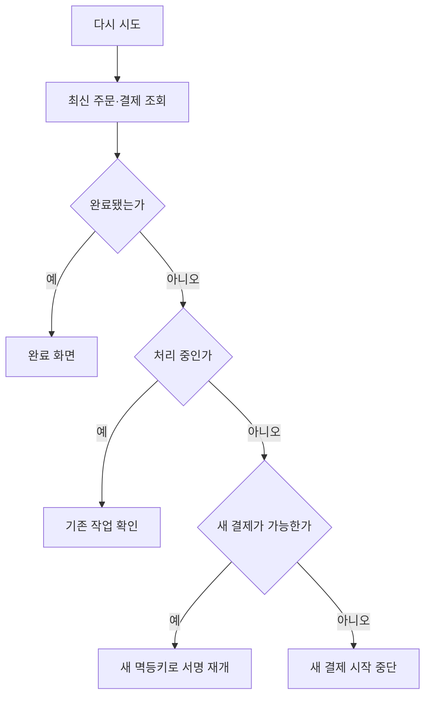
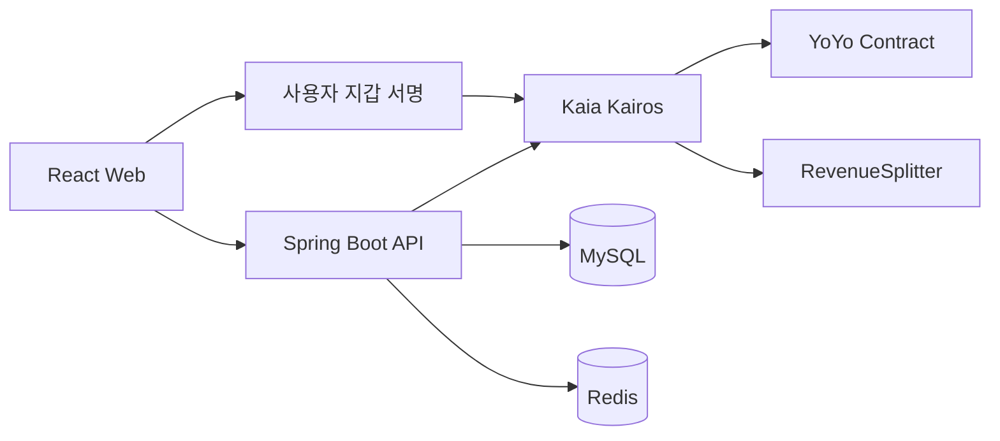

<div align="center">
  
  <p><strong>공동 공연의 티켓 예매부터 입장과 수익 정산까지</strong></p>
  <p>공연 탐색 · 팀 선택 · 지갑 서명 · QR 입장 · 공동 정산</p>
  
  
  
  
  <br /><br />
  <a href="#프로젝트-소개">소개</a> ·
  <a href="#서비스-화면">서비스 화면</a> ·
  <a href="#시스템-구조">시스템 구조</a> ·
  <a href="#담당-구현">담당 구현</a> ·
  <a href="#개발과-테스트">실행 안내</a>
</div>

---

## 프로젝트 소개

불러요는 여러 밴드가 함께 여는 소규모 공연의 티켓 예매·입장·수익 정산을 연결한 플랫폼입니다. 관객은 응원할 팀을 선택해 예매하고, 공연팀은 사전에 합의한 정산 규칙에 따라 분배 결과를 확인합니다.

Kaia Kairos 테스트넷과 YoYo 코인으로 거래 과정을 시연합니다. 법정화폐 결제나 실제 매출을 운영한 서비스는 아닙니다.

| 기간 | 팀 규모 | 프로젝트 | 담당 |
| --- | --- | --- | --- |
| 2026.08.26 ~ 2026.10.02 | 5명 | SSAFY 특화 프로젝트 · 핀테크 | 강병구 · 팀장 / Frontend |

## 서비스 화면

프로젝트 시연 당시의 실제 화면입니다. 화면마다 공연과 시연 데이터가 다를 수 있으며, YoYo 잔액과 거래 내역은 테스트넷 시연 값입니다. 이미지를 누르면 원본 크기로 볼 수 있습니다.

### 관객 · 공연을 찾고, 예매하고, 입장하기

`공연 탐색 → YoYo 잔액 확인 → 주문·지갑 결제 → 티켓 발급·QR 입장`

| 01 · 공연 탐색 | 02 · 잔액 확인 |
| :---: | :---: |
| <a href="docs/readme/screens/home.jpg"></a> | <a href="docs/readme/screens/wallet.jpg"></a> |
| 공연 포스터와 일정, 티켓 가격을 확인합니다. | 예매에 사용할 YoYo 잔액과 거래 내역을 확인합니다. |

#### 03 · 주문 확인과 결제

선택한 티켓 수량·응원 팀·결제 금액을 확인하고 지갑 결제를 진행합니다.

<a href="docs/readme/screens/order-confirm.jpg"></a>

<details>
<summary><strong>04 · 모바일 QR 검표 화면 보기</strong></summary>

관객의 티켓 QR을 검표 담당자가 확인하는 모바일 화면입니다. 아래 캡처는 **검증 실패 안내** 예시이며 입장 성공 화면이 아닙니다.

<a href="docs/readme/screens/entry-scan.jpg"></a>

</details>

결제 후 발급된 티켓은 [티켓 상세 화면](frontend/src/pages/TicketDetailPage.tsx)에서 확인합니다. 입장 QR은 30초마다 갱신되며 유효 시간은 60초입니다.

### 공연팀 · 공연을 관리하고, 정산 규칙을 준비하기

`공연 관리 → 정산 규칙 설정 → 팀별 규칙 합의 → 정산·분배 확인`

| 01 · 공연 관리 | 02 · 정산 규칙 설정 |
| :---: | :---: |
| <a href="docs/readme/screens/studio-dashboard.jpg"></a> | <a href="docs/readme/screens/settlement-rules.jpg"></a> |
| 참여 공연과 규칙 동의·보증금 납부 등 확인할 일을 모아 봅니다. | 고정 분배·관객 선택 비율과 팀별 분배 규칙을 설정합니다. |

규칙 합의와 정산 결과 확인은 다음 단계로 이어집니다. 관련 구현은 [규칙 동의](frontend/src/pages/AgreementsPage.tsx)와 [정산 대시보드](frontend/src/pages/SettlementPage.tsx)에서 볼 수 있습니다.

## 주요 기능

| 기능 | 처리 내용 |
| --- | --- |
| 공연 탐색 | 판매 중인 공연과 상세 정보 조회 |
| 티켓 예매 | 관람 목적 팀 선택, 주문 생성, 사용자 지갑 서명 |
| 결제 상태 | 서명 대기·처리 중·성공·실패에 따른 화면 처리 |
| 결제 재시도 | 최신 주문·결제 상태 확인 후 기존 작업 복원 또는 새로운 시도 시작 |
| 티켓과 입장 | 예매한 티켓 확인과 QR 기반 검표 |
| 공동 정산 | 팀별 규칙 합의, 테스트넷 거래와 분배 결과 확인 |

## 담당 구현

**강병구 · Frontend / 팀장** — 아래 개인 구현은 결제 상태·재시도 복구와 관련 테스트를 중심으로 정리했습니다. 서비스 화면은 팀 공동 산출물이며, 개발 과정에서 GPT·Codex의 도움을 받았습니다.

<details open>
<summary><strong>결제 상태와 실패 후 재시도</strong></summary>

서명 대기·처리 중·성공·실패를 구분하고, 최신 조회나 체인 작업으로 성공이 확인된 뒤 완료 화면으로 이동하도록 구현했습니다.

재시도 전에 주문·결제 상태를 다시 조회합니다. 처리 중인 작업이 있으면 새 결제를 시작하지 않고 기존 작업을 이어서 확인합니다. 실패 후 다시 결제할 수 있는 경우에는 새로운 멱등키로 서명을 재개하며, 실패한 작업을 다시 복원하지 않도록 처리했습니다.



- [결제 화면](frontend/src/pages/PaymentPage.tsx)
- [결제 상태·재시도 테스트](frontend/src/pages/PaymentPage.live.test.tsx)

</details>

<details>
<summary><strong>회귀 테스트와 팀 역할</strong></summary>

결제 정보 생성 전 404, 상태 충돌, 반영 지연, 실패 후 재서명, 연속 재시도 등 화면 상태가 잘못 전환될 수 있는 경계를 테스트에 반영했습니다.

| 역할 | 담당 범위 |
| --- | --- |
| UI/UX | 디자인 토큰, 공통 UI, 화면 마크업 |
| Frontend · 팀장 | 앱 골격, 화면 로직·서버 상태, 지갑 연동 |
| Backend | 체인 무관 도메인 API |
| Backend · Contract | YoYo·RevenueSplitter, 코인·정산 API |
| Infra · Server Chain | 실행 환경, 서버 체인 모듈, 검증 API, 배포 |

서버·스마트컨트랙트·인프라는 다른 팀원의 담당 범위입니다.

</details>

## 시스템 구조



프론트엔드는 서버 응답과 사용자 지갑 작업을 연결합니다. 블록체인 작업과 서버 상태 반영이 비동기로 이어지므로, API 접수나 화면 변경만으로 결제 완료를 판단하지 않습니다.

## 기술 스택

| 영역 | 기술 |
| --- | --- |
| Frontend | React 19, TypeScript, Vite, TanStack Query, React Router, Tailwind CSS |
| Wallet | Web3Auth, ethers, Kaia ethers extension |
| Backend | Java 17, Spring Boot, JPA, Flyway, MySQL, Redis |
| Blockchain | Solidity, Hardhat, OpenZeppelin, Kaia Kairos |
| Runtime | Docker Compose |

## 디렉터리 구조

```text
bulleoyo/
├── frontend/            # 관객·공연자·검표 화면 및 테스트
├── backend/             # Spring Boot API와 테스트
├── blockchain/          # YoYo·RevenueSplitter 컨트랙트
├── docs/                # 설계·기술 문서와 서비스 화면
├── exec/                # 프로젝트 산출물 경로
├── scripts/             # 개발 보조 스크립트
├── .gitlab/             # 기존 협업 템플릿
└── README.md
```

## 개발과 테스트

<details>
<summary><strong>로컬 개발 환경 준비</strong></summary>

각 서비스의 `.env.example`과 예시 설정을 참고해 로컬 환경을 준비합니다. 실제 비밀키와 운영 접속정보는 환경변수로 주입합니다.

```bash
# Frontend
cd frontend
corepack enable
pnpm install
pnpm dev

# Backend — 별도 터미널
cd backend
./gradlew bootRun --args='--spring.profiles.active=local'

# Contract — 별도 터미널
cd blockchain
pnpm install
pnpm test
```

</details>

<details>
<summary><strong>테스트 실행</strong></summary>

```bash
cd frontend
pnpm test

cd backend
./gradlew test

cd blockchain
pnpm test
```

지갑 로그인과 테스트넷 거래에는 별도 로컬 설정이 필요합니다. 운영 키와 출처 확인이 필요한 데이터·자산을 포함하지 않으므로 실행 환경은 직접 준비해야 합니다.

</details>
